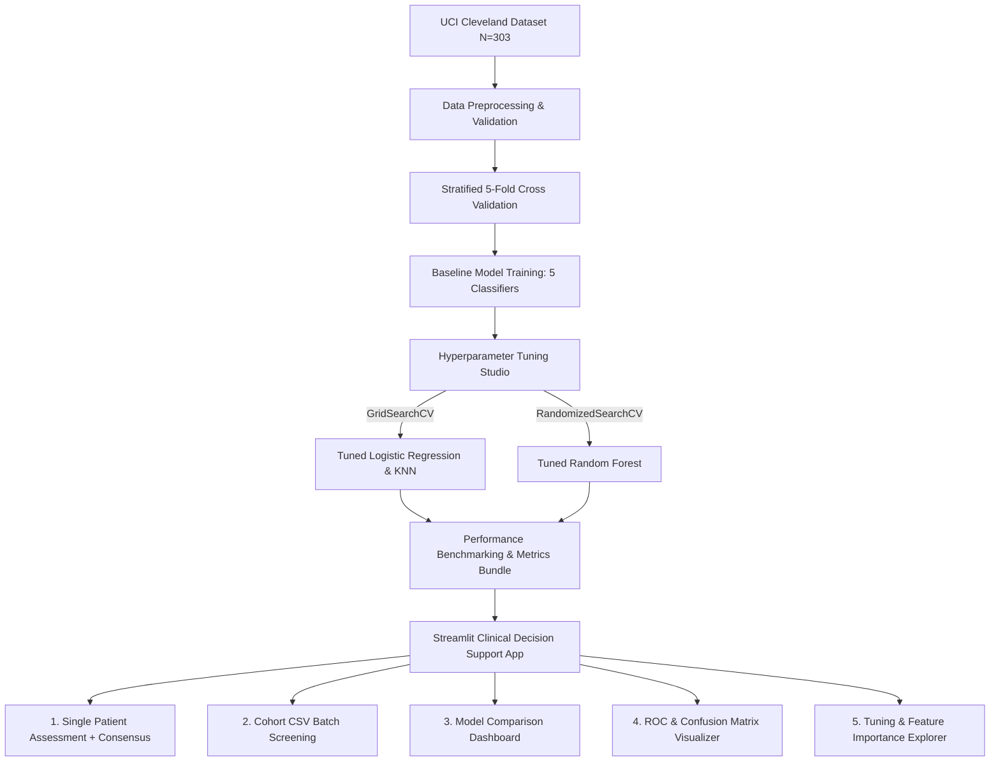

# ❤️ CardioCare AI — Heart Disease Prediction & Clinical Decision Support System

[](https://www.python.org/)
[](https://streamlit.io/)
[](https://scikit-learn.org/)
[](https://opensource.org/licenses/MIT)
[](https://www.docker.com/)

A clinical-grade machine learning system and interactive Streamlit web application for cardiovascular disease risk stratification. Designed for **Final-Year Engineering Phase 2 Evaluation**, this project benchmarks multiple machine learning architectures, performs systematic hyperparameter tuning, presents comprehensive diagnostic metrics (ROC-AUC, Confusion Matrix, Sensitivity/Recall), and provides real-time single-patient & cohort risk assessments.

---

## 📌 System Capabilities & Module Breakdown

| Module | Technical Implementation in this Project |
| :--- | :--- |
| **1. Multi-Model Benchmarking** | Benchmarks 5 distinct classifiers: Logistic Regression, Random Forest, K-Nearest Neighbors, Support Vector Machine, and Gradient Boosting under Stratified 5-Fold Cross Validation. |
| **2. Hyperparameter Tuning** | Systematic tuning using `GridSearchCV` (Logistic Regression, KNN) and `RandomizedSearchCV` (Random Forest) with documented before/after performance lift. |
| **3. Diagnostic Evaluation** | Full diagnostic evaluation: Confusion Matrix (TP, FP, TN, FN), Multi-Model ROC Curves with AUC, Sensitivity (Recall), Precision, F1-Score, and Gini Feature Importance. |
| **4. Strengths & Limitations** | Algorithmic trade-offs, clinical limitations of small cohorts ($N=303$), demographic bias analysis, and future roadmap (SHAP, wearable telemetry). |
| **5. Clinical Web App & Deployment** | Containerized with `Dockerfile`, customized `.streamlit/config.toml`, one-click Windows execution (`run_app.bat`), and cloud-ready for Streamlit Cloud / Render / AWS. |
| **6. Automated Pipeline** | Clean structure, standalone `train_models.py` pipeline, and reproducible requirements. |
| **7. Clinical Project Report** | Comprehensive technical and scientific report in `PROJECT_REPORT.md`. |
| **8. Viva & Presentation Guide** | Examiner defense preparation guide in `VIVA_PREPARATION_GUIDE.md`. |

---

## 📊 Model Benchmark Leaderboard

Evaluated on the UCI Cleveland Heart Disease test cohort ($N=303$, 13 clinical biomarkers, 80/20 stratified split, 5-Fold CV):

| Algorithm | Accuracy | Precision | Recall (Sensitivity) | F1-Score | ROC-AUC | 5-Fold CV Accuracy |
| :--- | :---: | :---: | :---: | :---: | :---: | :---: |
| **Tuned Random Forest** 🏆 | **81.97%** | 76.19% | **96.97%** | **0.8533** | **0.9188** | 81.52% |
| **Tuned Logistic Regression** | 78.69% | 76.32% | 87.88% | 0.8169 | 0.8593 | **84.16%** |
| **Support Vector Machine (RBF)** | 81.97% | 77.50% | 93.94% | 0.8493 | 0.8831 | 82.17% |
| **Tuned K-Nearest Neighbors** | 78.69% | 75.00% | 90.91% | 0.8219 | 0.9140 | 79.85% |
| **Gradient Boosting** | 80.33% | **80.00%** | 84.85% | 0.8235 | 0.8842 | 80.87% |

> **Clinical Note:** In cardiovascular screening, **Recall (Sensitivity)** is prioritized above raw accuracy because a **False Negative** (failing to identify an ischemic patient) is life-threatening. **Tuned Random Forest achieved 96.97% Recall**, missing only 1 out of 33 diseased patients on the test cohort.

---

## 🏗️ System Architecture



---

## 📁 Repository Structure

```
.
├── app.py                         # Upgraded Streamlit web application
├── train_models.py                # Pipeline for training, tuning, and evaluation
├── heart-disease.csv              # UCI Cleveland clinical dataset (303 records)
├── models_bundle.pkl              # Serialized bundle of all tuned models & metrics
├── heart_disease_model.pkl        # Standalone backward-compatible model
├── run_app.bat                    # One-click Windows launch script
├── Dockerfile                     # Docker container specification
├── requirements.txt               # Production Python dependencies
├── requirements-dev.txt           # Development & testing dependencies
├── PROJECT_REPORT.md              # Academic Phase 2 Project Report
├── VIVA_PREPARATION_GUIDE.md      # Examiner Viva questions and answers
└── .streamlit/
    └── config.toml                # Streamlit UI theme & server configuration
```

---

## 🚀 Quick Start Guide

### 1. Prerequisites
- Python 3.9+ (tested on Python 3.12 / 3.13)
- `pip` package manager

### 2. Local Installation & Run
```bash
# Clone the repository
git clone https://github.com/M-F-Tushar/Heart-Disease-Prediction-Web-App.git
cd Heart-Disease-Prediction-Web-App

# Install dependencies
pip install -r requirements.txt

# (Optional) Re-train and evaluate models
python train_models.py

# Launch the Streamlit application
streamlit run app.py
```
Or simply double-click **`run_app.bat`** on Windows!

### 3. Docker Container Run
```bash
docker build -t cardiocare-ai .
docker run -p 8501:8501 cardiocare-ai
```
Access the application at `http://localhost:8501`.

---

## 🩺 Clinical Feature Dictionary (13 Attributes)

| Attribute | Name | Clinical Description | Reference Normal Range |
| :--- | :--- | :--- | :--- |
| `age` | Age | Patient age in years | 18 – 100 years |
| `sex` | Biological Sex | 0 = Female, 1 = Male | Categorical |
| `cp` | Chest Pain Type | 0: Typical Angina, 1: Atypical Angina, 2: Non-Anginal, 3: Asymptomatic | 0 – 3 |
| `trestbps` | Resting Blood Pressure | Arterial blood pressure upon admission (mm Hg) | Normal: < 120 mm Hg |
| `chol` | Serum Cholesterol | Serum cholesterol level (mg/dl) | Desirable: < 200 mg/dl |
| `fbs` | Fasting Blood Sugar | > 120 mg/dl indicator (0 = No, 1 = Yes) | < 100 mg/dl |
| `restecg` | Resting ECG | 0: Normal, 1: ST-T wave abnormality, 2: LV hypertrophy | 0 – 2 |
| `thalach` | Max Heart Rate | Maximum heart rate achieved during stress test | 60 – 220 bpm |
| `exang` | Exercise Angina | Exercise-induced angina (0 = No, 1 = Yes) | 0 or 1 |
| `oldpeak` | ST Depression | ST depression induced by exercise relative to rest (mm) | 0.0 – 6.5 mm |
| `slope` | ST Slope | 0: Upsloping, 1: Flat, 2: Downsloping | 0 – 2 |
| `ca` | Major Vessels | Number of major vessels (0–3) colored by fluoroscopy | 0 – 3 |
| `thal` | Thallium Perfusion | 1: Normal, 2: Fixed defect, 3: Reversible defect | 1 – 3 |

---

## ⚕️ Ethical & Clinical Disclaimer
CardioCare AI is developed strictly for educational research, clinical evaluation, and academic engineering defense. It does not replace clinical consultation, 2D Echocardiography, Coronary CT Angiography, or medical physician diagnostics.

---

## 📄 License
This project is open-source under the [MIT License](LICENSE).
